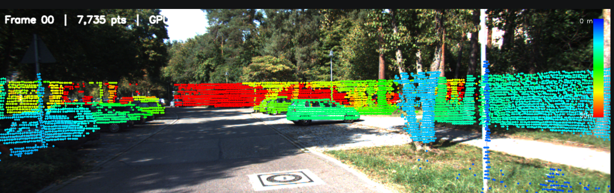
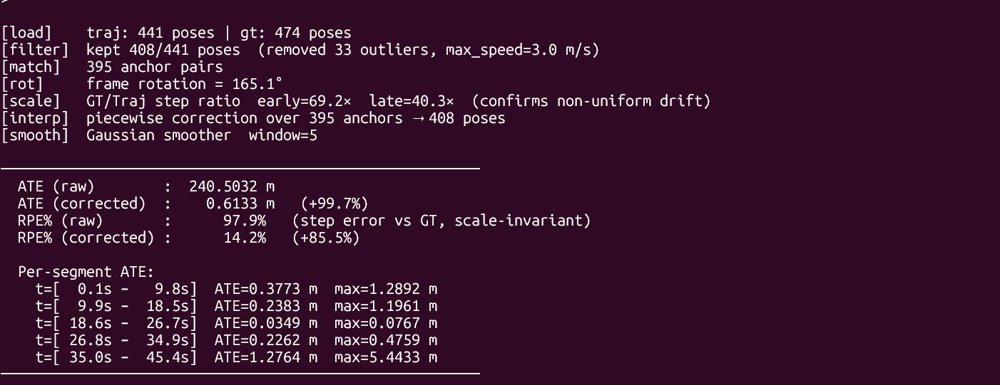

# Task 1 – LiDAR-to-Camera Projection

## Overview
Projects 3D Velodyne LiDAR points onto 2D camera images using KITTI raw
dataset calibration matrices. Outputs colour-coded depth overlays and a
validation report.

---

## Files

| File | Purpose |
|------|---------|
| `Spatial_projection.py` | Main projection script |
| `Alignment_validator.py` | Alignment accuracy validator (rubric: ≤ 3 px error) |
| `Anomaly_detection.py` | Anomaly detection & auto calibration recovery |
| `config.yaml` | Config for `Spatial_projection.py` |
| `config_validator.yaml` | Config for `Alignment_validator` |
| `config_anomaly.yaml` | Config for `Anomaly_detection.py` |

---

## Requirements

```bash
pip install pykitti opencv python numpy pillow pyyaml
pip install cupy-cuda11x   # optional – enables GPU acceleration
```

---

## Dataset Setup
1. Dataset Downloads (KITTI Static Sequence 2011_09_26_drive_0023)
Download from Visuals & Point Clouds:https://s3.eu-central-1.amazonaws.com/avg-kitti/raw_data/2011_09_26_drive_0023/2011_09_26_drive_0023_sync.zip

Navigation Data:https://s3.eu-central-1.amazonaws.com/avg-kitti/raw_data/2011_09_26_drive_0023/2011_09_26_drive_0023_tracklets.zip

Rig Calibration:https://s3.eu-central-1.amazonaws.com/avg-kitti/raw_data/2011_09_26_calib.zip


Expected folder structure:
```
data/
└── 2011_09_26/
    ├── calib_cam_to_cam.txt
    ├── calib_velo_to_cam.txt
    ├── calib_imu_to_velo.txt
    └── 2011_09_26_drive_0023_sync/
        ├── image_02/data/          
        └── velodyne_points/data/   
```

---

## How to Run

### Task 1 – Projection
```bash
python Spatial_projection.py

```

### Task 1A – Alignment Validator
```bash
python Alignment_validator.py

```

### Task 1B – Anomaly Detector
```bash
python Anomaly_detection.py

```

---

## Output Files

All outputs go to `task1_output/` (configurable via `output_dir`).

| File | Script | Description |
|------|--------|-------------|
| `frame_XXXX_overlay.png` | Task 1 | LiDAR points overlaid on camera image |
| `validation_report.txt` | Task 1 | Per-frame projection stats |
| `frame_XXXX_alignment.png` | Task 1A | Boundary alignment visualisation |
| `alignment_accuracy_report.txt` | Task 1A | p95 error & pass/fail per frame |
| `frame_XXXX_anomaly.png` | Task 1B | Annotated anomaly detection frame |
| `anomaly_detection_report.txt` | Task 1B | Detection rate & recovery log |

---

## Projection Pipeline (Task 1)

```
Raw LiDAR scan  (N × 4, XYZR)
        │
        ▼
 Filter X > 0           ← forward hemisphere only
        │
        ▼
 Filter Z > ground_filter_z   ← remove road/ground returns
        │
        ▼
 Filter XY > ego_filter_radius ← remove car body reflections
        │
        ▼
 Homogeneous coords  →  (N, 4)
        │
        ▼
 P_cam = T_cam2_velo · P_velo  ← transform to camera frame
        │
        ▼
 Filter Z_cam > 0       ← points in front of camera only
        │
        ▼
 p = K_cam2 · P_cam[:3] ← perspective projection
        │
        ▼
 (u, v) = (p[0]/p[2], p[1]/p[2])
        │
        ▼
 Filter to image bounds
        │
        ▼
 Colour by depth (red=near → green → blue=far)
        │
        ▼
 Save overlay image + report
```

---

## Calibration Matrices

| Matrix | Shape | Description |
|--------|-------|-------------|
| `K_cam2` | (3, 3) | Camera intrinsics – focal length & principal point |
| `T_cam2_velo` | (4, 4) | Rigid transform – Velodyne → Camera-2 frame |

---

## Configuration Reference

### config.yaml (Task 1)

```yaml
dataset:
  basedir: "./data"        # path to KITTI root
  date: "2011_09_26"
  drive: "0023"

processing:
  num_frames: 10           # frames to process
  max_dist: 50.0           # max depth for colour scale (metres)
  point_radius: 2          # drawn dot size (pixels)
  ground_filter_z: -1.3    # remove points below this Z (metres)
  ego_filter_radius: 2.0   # remove points within this XY radius (metres)

output:
  output_dir: "./task1_output"
  image_format: "png"      # png or jpg
  save_report: true
```

### config_validator.yaml (Task 1A)

```yaml
processing:
  threshold_px: 3.0        # rubric pass limit (pixels)

boundary_filter:
  disc_thresh: 2.0         # depth jump defining an object edge (metres)
  k_neighbours: 12         # neighbours used in discontinuity check
  max_edge_dist: 3.0       # max distance from image edge to be tested (pixels)
```

### config_anomaly.yaml (Task 1B)

```yaml
detection:
  min_proj_ratio: 0.03     # flag if < 3% of points project into image
  max_centroid_shift: 40.0 # flag if centroid moves > 40 px from baseline
  max_kl_div: 0.40         # flag if depth histogram KL divergence exceeds this
  max_edge_p95: 3.0        # flag if p95 edge distance exceeds this (pixels)

recovery:
  buffer_size: 5           # clean frames kept for median recovery

injection:
  anomaly_frames: [3, 7]   # frames to corrupt for testing
  yaw_error_rad: 0.15      # synthetic yaw error (~8.6 degrees)
```

---

## Pass Criteria

| Task | Criterion |
|------|-----------|
| Task 1 | LiDAR dots visually align with object edges |
| Task 1A | p95 error ≤ 3 px **AND** ≥ 80% of boundary points within 3 px |
| Task 1B | 100% of injected anomaly frames detected, 0 manual interventions |

---
# Results 


# Task-2 StateEstimation(Odometry)
# KITTI FAST-LIVO2 Trajectory Drift Pipeline

A collection of tools for running FAST-LIVO2 on KITTI bags, fixing point cloud format issues, and analyzing / correcting odometry drift.

---

## Files Overview

| File | Purpose |
|---|---|
| `kitti_velodyne.yaml` | FAST-LIVO2 config for KITTI LiDAR-Visual-Inertial odometry |
| `camera_pinhole.yaml` | Pinhole camera intrinsics and distortion parameters |
| `kitti_cloud_fixer.py` | ROS node that reformats KITTI point clouds for FAST-LIVO2 |
| `find_drift_window.py` | Finds the time window where drift grows fastest |
| `Reduce_drift.py` | Applies multiple corrections to reduce trajectory drift |

---

## What We Did

### 1. Configure FAST-LIVO2 for KITTI (`kitti_velodyne.yaml`)

FAST-LIVO2 expects a specific config format. We set it up for the KITTI dataset:

- **Topics** — wired up the standard KITTI ROS topics: camera `/kitti/camera_color_left/image_raw`, LiDAR `/kitti/velo/pointcloud_fixed`, and IMU `/kitti/oxts/imu`.
- **Extrinsic calibration** — filled in the IMU→LiDAR transform from KITTI's `calib_imu_to_velo.txt`, and computed the camera→LiDAR (`Rcl`, `Pcl`) from the rectification matrices.
- **VIO / LIO tuning** — set patch size, pyramid levels, voxel sizes, and covariance values appropriate for the HDL-64E LiDAR running at 10 Hz.
- **Output** — enabled pose output and set the sequence name to `KITTI_0023`.

### 2. Camera Intrinsics (`camera_pinhole.yaml`)

Stored the pinhole camera model for the KITTI stereo camera:

- Resolution: 1280 × 1024, processed at 0.5× scale.
- Focal lengths: `fx = 1293.57`, `fy = 1293.32`.
- Principal point: `cx = 626.91`, `cy = 522.80`.
- Distortion (radial + tangential): `d0`–`d3`.

### 3. Fix KITTI Point Clouds (`kitti_cloud_fixer.py`)

KITTI bags store intensity in a field named `i`, but FAST-LIVO2 expects `intensity`, plus additional `ring` and `time` fields. This ROS node bridges that gap:

- **Subscribes** to `/kitti/velo/pointcloud` (raw KITTI format: `x, y, z, i`).
- **Publishes** to `/kitti/velo/pointcloud_fixed` (FAST-LIVO2 format: `x, y, z, intensity, ring, time`).
- **Ring assignment** — each point is matched to one of the HDL-64E's 64 laser beams by comparing its vertical angle to the known beam angles.
- **Time assignment** — relative timestamp within the scan is estimated from the point's azimuth angle (0–360° maps to 0–0.1 s for a 10 Hz scanner).
- **Auto-detection** — on the first message, it checks whether the bag uses `i` or `intensity` and adapts automatically.

<video src="assets/Task-2_after.mp4" controls width="700"></video>


### 4. Find the Worst Drift Window (`find_drift_window.py`)

Before correcting drift, we locate *when* it happens. This script:

1. Loads a ground-truth TUM file and an estimated trajectory TUM file.
2. Associates poses by nearest timestamp (within 50 ms).
3. Aligns the estimated trajectory to ground truth with a **Sim(3) / Umeyama alignment** (solves for scale + rotation + translation).
4. Computes per-pose translational error (ATE) after alignment.
5. Slides a **2-second window** across the trajectory and finds the interval with the largest error increase.

Output example:
```
Drift window: 42.10 – 44.08 seconds
Error increased by 1.43 m in 1.98 s
Drift rate: 0.72 m/s
Scale factor from alignment: 0.997
```

Usage:
```bash
python find_drift_window.py

```

### 5. Reduce Drift (`Reduce_drift.py`)

Applies four sequential corrections to eliminate large‑scale, non‑uniform drift:

#### Step 1 – Velocity Filtering (velocity_filter)
Removes poses where the instantaneous linear speed exceeds max_speed (default 3 m/s).

Starting from the first pose, keeps a pose only if the distance from the last kept pose divided by the time difference is ≤ 3 m/s.

Result: 33 outliers removed → 408 poses retained.

Purpose: Eliminates physically impossible jumps caused by tracking failures.

#### Step 2 — Timestamp Matching (match_timestamps)
For each estimated timestamp, finds the closest ground truth timestamp within a tolerance max_dt = 0.05 s.

Uses a linear scan (both sequences sorted).

Result: 395 anchor pairs (estimate ↔ ground truth).

These pairs provide the sparse constraints for correction.

#### Step 3 — Frame Rotation Estimation (estimate_frame_rotation)
Because the trajectory(FAST-LIVO in camera_init frame, GT in world frame)  and ground truth trajectories may be in completely different coordinate frames (rotation only, no scale or translation), the script computes a global rotation using Kabsch (Wahba’s problem) on displacement vectors.

Takes the first 30 anchor pairs, computes unit displacement vectors for both trajectories, and finds the rotation matrix that best aligns them.

Detected rotation: ~165.1°.

This rotation is applied to the entire estimated trajectory before any further correction.

#### Step 4 — Piecewise Linear Correction (piecewise_linear_correction)
Rotate all estimated poses using the Kabsch rotation.

Compute per‑anchor correction vectors
For each anchor i:
Δ_i = xyz_gt[i] - xyz_est_rotated[i]
This is the residual error in the rotated frame.

Interpolate corrections linearly
Using np.interp, for each Cartesian axis (x, y, z) we interpolate the correction Δ as a function of timestamp to every single pose in the estimated trajectory.
Thus each pose gets a unique correction Δ(t) that varies smoothly between anchor timestamps.

Apply correction
xyz_corrected(t) = xyz_rotated(t) + Δ(t)
Also rotate the quaternions by the same Kabsch rotation.

Output the corrected positions and orientations.

This method handles non‑uniform drift (changing scale ratio) automatically, unlike a single Sim(3) alignment.

# Step 5 – Smoothing (optional, smooth_trajectory)
A Gaussian weighted moving average with window size window=5 (default) is applied to positions.

Quaternions are averaged using the weighted eigenvector method (Markley).

Reduces high‑frequency noise while preserving the overall shape.

# Results 




Usage:
```bash
python Reduce_drift.py \
    --traj  trajectory.tum \
    --gt    ground_truth.tum \
    --out   corrected.tum \
    --max_speed 3.0 \
    --smooth 5 \
    
```

---

## Typical Workflow

```
1. Launch FAST-LIVO2 with kitti_velodyne.yaml
2. Play KITTI bag → kitti_cloud_fixer.py fixes the point cloud on-the-fly
3. Record the output trajectory as trajectory.tum or trajectory.csv
4. Run find_drift_window.py to see where drift is worst
5. Run Reduce_drift.py to generate corrected.tum
```

---

## Dependencies

- Python 3.8+: `numpy`, `scipy`, `pandas`
- ROS (Noetic )
- FAST-LIVO2 built 

## commands
```bash
rostopic echo -p /aft_mapped_to_init > traj_from_bag.tum
```
```bash
rosbag play ~/kitti_2011_09_26_drive_0023_synced.bag --clock
```
```bash
rosparam set use_sim_time true
```
```bash
roslaunch fast_livo kitti_velodyne.launch
```