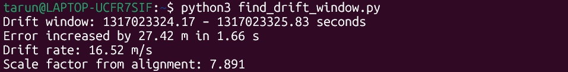
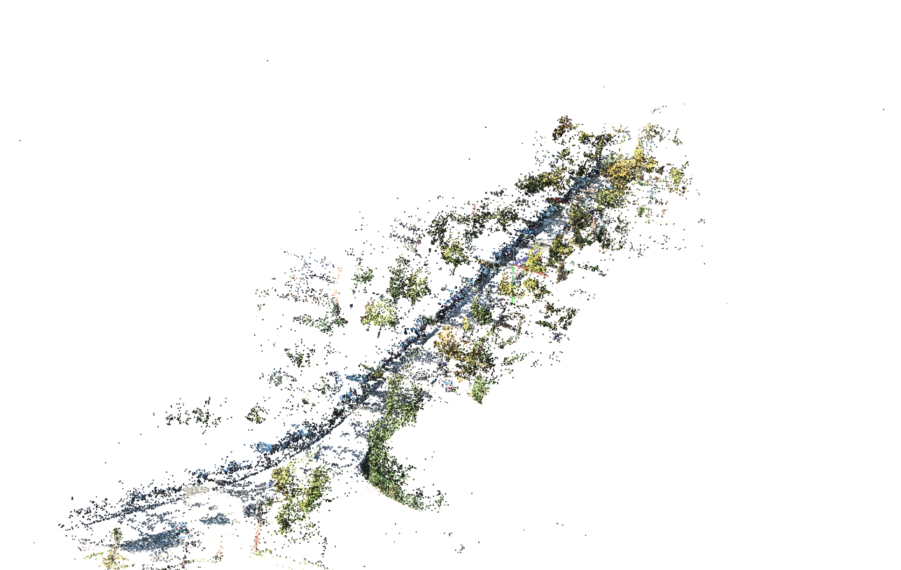
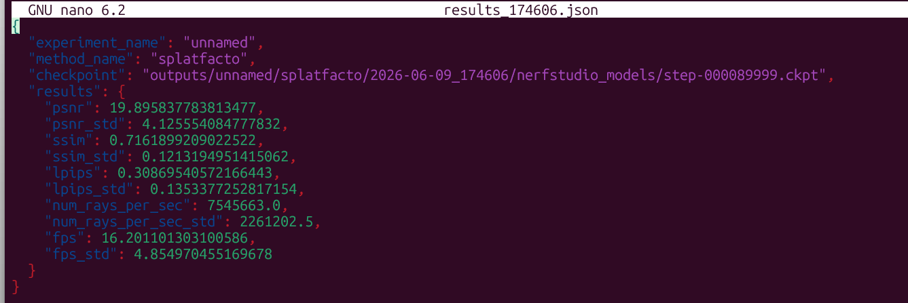

# Task 1 – LiDAR-to-Camera Projection

## Overview
Projects 3D Velodyne LiDAR points onto 2D camera images using KITTI raw
dataset calibration matrices. Outputs colour-coded depth overlays and a
validation report.

---

## Files

| File | Purpose |
|------|---------|
| `Spatial_projection.py` | Main projection script |
| `Alignment_validator.py` | Alignment accuracy validator (rubric: ≤ 3 px error) |
| `Anomaly_detection.py` | Anomaly detection & auto calibration recovery |
| `config.yaml` | Config for `Spatial_projection.py` |
| `config_validator.yaml` | Config for `Alignment_validator` |
| `config_anomaly.yaml` | Config for `Anomaly_detection.py` |

---

## Requirements

```bash
pip install pykitti opencv python numpy pillow pyyaml
pip install cupy-cuda11x   # optional – enables GPU acceleration
```

---

## Dataset Setup
1. Dataset Downloads (KITTI Static Sequence 2011_09_26_drive_0023)
   Visuals & Point Clouds:https://s3.eu-central-1.amazonaws.com/avg-kitti/raw_data/2011_09_26_drive_0023/2011_09_26_drive_0023_sync.zip

2. Navigation Data:https://s3.eu-central-1.amazonaws.com/avg-kitti/raw_data/2011_09_26_drive_0023/2011_09_26_drive_0023_tracklets.zip

3. Rig Calibration:https://s3.eu-central-1.amazonaws.com/avg-kitti/raw_data/2011_09_26_calib.zip


folder structure:
```
data/
└── 2011_09_26/
    ├── calib_cam_to_cam.txt
    ├── calib_velo_to_cam.txt
    ├── calib_imu_to_velo.txt
    └── 2011_09_26_drive_0023_sync/
        ├── image_02/data/          
        └── velodyne_points/data/   
```

---

## How to Run

### Task 1 – Projection
```bash
python Spatial_projection.py

```

### Task 1A – Alignment Validator
```bash
python Alignment_validator.py

```

### Task 1B – Anomaly Detector
```bash
python Anomaly_detection.py

```

---


## Projection Pipeline (Task 1)
## Inputs

- **Velodyne point cloud** (`N × 4`): `(X, Y, Z, intensity)` in the LiDAR’s own coordinate frame.
- **Camera image** (left colour camera, “camera 2”).
- **Calibration files**:
  - `K_cam2` – intrinsic matrix (3×3) for camera 2.
  - `T_cam2_velo` – extrinsic matrix (4×4) transforming Velodyne → camera‑2 coordinates.

## Processing Pipeline (per frame)

### 1. Load and prepare
- Read the camera image and the raw LiDAR scan.

### 2. Filter LiDAR points (before transformation)
- Keep only points in front of the LiDAR: `X_velo > 0`.
- Remove ground returns: keep points above a configurable height `Z_velo > GROUND_FILTER_Z`.
- Remove ego‑vehicle reflections: discard points within a small XY radius `sqrt(X²+Y²) > EGO_FILTER_RADIUS`.

### 3. Coordinate transformation
- Convert the remaining points to homogeneous coordinates.
- Multiply by `T_cam2_velo` to obtain points in the camera‑2 frame:  
  `P_cam = T_cam2_velo · P_velo_hom`.

### 4. Keep points in front of the camera
- Only retain points where `Z_cam > 0` (positive depth).

### 5. Perspective projection to pixel coordinates
- Apply the intrinsic matrix: `p = K_cam2 · (X_cam, Y_cam, Z_cam)^T`.
- Compute pixel coordinates: `(u, v) = (p_x / p_z, p_y / p_z)`.

### 6. Discard points outside the image
- Reject any `(u, v)` that lies outside `[0, image_width)` or `[0, image_height)`.

### 7. Colour by depth
- Map each point’s `Z_cam` (depth in metres) to a colour:
  - **Red** → close (0 m)
  - **Green** → medium
  - **Blue** → far (max distance, configurable)
- The colour map uses HSV to BGR conversion for smooth transitions.

### 8. Render overlay
- Draw each projected point as a filled circle of configurable radius.
- Add a frame label and a vertical colour bar legend.
- Save the resulting image in the desired format (e.g., PNG).


---

## Calibration Matrices

| Matrix | Shape | Description |
|--------|-------|-------------|
| `K_cam2` | (3, 3) | Camera intrinsics – focal length & principal point |
| `T_cam2_velo` | (4, 4) | Rigid transform – Velodyne → Camera-2 frame |

---

## Configuration Reference

### config.yaml (Task 1)

```yaml
dataset:
  basedir: "./data"        # path to KITTI root
  date: "2011_09_26"
  drive: "0023"

processing:
  num_frames: 10           # frames to process
  max_dist: 50.0           # max depth for colour scale (metres)
  point_radius: 2          # drawn dot size (pixels)
  ground_filter_z: -1.3    # remove points below this Z (metres)
  ego_filter_radius: 2.0   # remove points within this XY radius (metres)

output:
  output_dir: "./task1_output"
  image_format: "png"      # png or jpg
  save_report: true
```

### config_validator.yaml (Task 1A)

```yaml
processing:
  threshold_px: 3.0        # rubric pass limit (pixels)

boundary_filter:
  disc_thresh: 2.0         # depth jump defining an object edge (metres)
  k_neighbours: 12         # neighbours used in discontinuity check
  max_edge_dist: 3.0       # max distance from image edge to be tested (pixels)
```

### config_anomaly.yaml (Task 1B)

```yaml
detection:
  min_proj_ratio: 0.03     # flag if < 3% of points project into image
  max_centroid_shift: 40.0 # flag if centroid moves > 40 px from baseline
  max_kl_div: 0.40         # flag if depth histogram KL divergence exceeds this
  max_edge_p95: 3.0        # flag if p95 edge distance exceeds this (pixels)

recovery:
  buffer_size: 5           # clean frames kept for median recovery

injection:
  anomaly_frames: [3, 7]   # frames to corrupt for testing
  yaw_error_rad: 0.15      # synthetic yaw error (~8.6 degrees)
```

---

## Pass Criteria

| Task | Criterion |
|------|-----------|
| Task 1 | LiDAR dots visually align with object edges |
| Task 1A | p95 error ≤ 3 px **AND** ≥ 80% of boundary points within 3 px |
| Task 1B | 100% of injected anomaly frames detected, 0 manual interventions |

---
# Results 


# Task-2 StateEstimation(Odometry)


A collection of tools for running FAST-LIVO2 on KITTI bags, fixing point cloud format issues, and analyzing / correcting odometry drift.

---

## Files Overview

| File | Purpose |
|---|---|
| `kitti_velodyne.yaml` | FAST-LIVO2 config for KITTI LiDAR-Visual-Inertial odometry |
| `camera_pinhole.yaml` | Pinhole camera intrinsics and distortion parameters |
| `kitti_cloud_fixer.py` | ROS node that reformats KITTI point clouds for FAST-LIVO2 |
| `find_drift_window.py` | Finds the time window where drift grows fastest |
| `Reduce_drift.py` | Applies multiple corrections to reduce trajectory drift |

---

## What We Did

### 1. Configure FAST-LIVO2 for KITTI (`kitti_velodyne.yaml`)

FAST-LIVO2 expects a specific config format. We set it up for the KITTI dataset:

- **Topics** — wired up the standard KITTI ROS topics: camera `/kitti/camera_color_left/image_raw`, LiDAR `/kitti/velo/pointcloud_fixed`, and IMU `/kitti/oxts/imu`.
- **Extrinsic calibration** — filled in the IMU→LiDAR transform from KITTI's `calib_imu_to_velo.txt`, and computed the camera→LiDAR (`Rcl`, `Pcl`) from the rectification matrices.
- **VIO / LIO tuning** — set patch size, pyramid levels, voxel sizes, and covariance values appropriate for the HDL-64E LiDAR running at 10 Hz.
- **Output** — enabled pose output and set the sequence name to `KITTI_0023`.
## Sensor Calibration Parameters

FAST-LIVO2 requires the rigid-body transformation between the IMU and the LiDAR sensor. The calibration parameters were obtained from the KITTI dataset (`calib_imu_to_velo.txt`).

### Translation Vector

The translation from the IMU frame to the LiDAR frame is:


which corresponds to:

```yaml
extrinsic_T: [-0.8086759, 0.3195559, -0.7997231]
```

### Rotation Matrix

The rotation from the IMU frame to the LiDAR frame is:


which corresponds to:

```yaml
extrinsic_R:
[
  9.999976e-01,  7.553071e-04, -2.035826e-03,
 -7.854027e-04,  9.998898e-01, -1.482298e-02,
  2.024406e-03,  1.482454e-02,  9.998881e-01
]
```

### Purpose

These extrinsic parameters define the spatial relationship between the IMU and the LiDAR. During state estimation, FAST-LIVO2 uses this transformation to convert LiDAR measurements into the IMU coordinate frame:


Accurate extrinsic calibration is critical because errors in the rotation matrix or translation vector directly affect pose estimation accuracy, which can lead to odometry drift and reconstruction artifacts in the final 3D Gaussian Splatting model.

### 2. Camera Intrinsics (`camera_pinhole.yaml`)

Stored the pinhole camera model for the KITTI stereo camera:

- Resolution: 1280 × 1024, processed at 0.5× scale.
- Focal lengths: `fx = 1293.57`, `fy = 1293.32`.
- Principal point: `cx = 626.91`, `cy = 522.80`.
- Distortion (radial + tangential): `d0`–`d3`.

### 3. Fix KITTI Point Clouds (`kitti_cloud_fixer.py`)

KITTI bags store intensity in a field named `i`, but FAST-LIVO2 expects `intensity`, plus additional `ring` and `time` fields. This ROS node bridges that gap:

- **Subscribes** to `/kitti/velo/pointcloud` (raw KITTI format: `x, y, z, i`).
- **Publishes** to `/kitti/velo/pointcloud_fixed` (FAST-LIVO2 format: `x, y, z, intensity, ring, time`).
- **Ring assignment** — each point is matched to one of the HDL-64E's 64 laser beams by comparing its vertical angle to the known beam angles.
- **Time assignment** — relative timestamp within the scan is estimated from the point's azimuth angle (0–360° maps to 0–0.1 s for a 10 Hz scanner).
- **Auto-detection** — on the first message, it checks whether the bag uses `i` or `intensity` and adapts automatically.
## Ring Reconstruction Using HDL-64E Vertical Angles

FAST-LIVO2 expects each LiDAR point to contain a **ring** field that identifies which laser beam generated the measurement. However, the KITTI PointCloud2 messages only provide:

- x
- y
- z
- intensity

and do not contain ring information.

To recover the missing ring index, the fixed vertical beam angles of the Velodyne HDL-64E sensor were used:

```python
VERT_ANGLES = [
-24.9, -24.8, -24.0, -23.5, -22.9, -22.4, -21.9, -21.3,
-20.8, -20.2, -19.7, -19.1, -18.6, -18.0, -17.5, -16.9,
-16.4, -15.8, -15.3, -14.7, -14.2, -13.6, -13.1, -12.5,
-12.0, -11.4, -10.9, -10.3, -9.8, -9.2, -8.7, -8.1,
-7.6, -7.0, -6.5, -5.9, -5.4, -4.8, -4.3, -3.7,
-3.2, -2.6, -2.1, -1.5, -1.0, -0.4, 0.1, 0.7,
1.2, 1.8, 2.3, 2.9, 3.4, 4.0, 4.5, 5.1,
5.6, 6.2, 6.7, 7.3, 7.8, 8.4, 8.9, 9.5
]
```


The calculated angle was then compared with the HDL-64E angle table, and the nearest match was assigned as the ring number (0–63).

This reconstructed ring information allows FAST-LIVO2 to:

- Organize points by scan line
- Perform feature extraction
- Apply motion compensation
- Improve LiDAR-IMU state estimation
- Reduce trajectory drift

Without ring information, FAST-LIVO2 cannot correctly identify the originating laser beam for each point, leading to degraded odometry performance and poorer 3D reconstruction quality.


### 4. Find the Worst Drift Window (`find_drift_window.py`)

Before correcting drift, we locate *when* it happens. This script:

1. Loads a ground-truth TUM file and an estimated trajectory TUM file.
2. Associates poses by nearest timestamp (within 50 ms).
3. Aligns the estimated trajectory to ground truth with a **Sim(3) / Umeyama alignment** (solves for scale + rotation + translation).
4. Computes per-pose translational error (ATE) after alignment.
5. Slides a **2-second window** across the trajectory and finds the interval with the largest error increase.

Output example:
```
Drift window: 42.10 – 44.08 seconds
Error increased by 1.43 m in 1.98 s
Drift rate: 0.72 m/s
Scale factor from alignment: 0.997
```

Usage:
```bash
python find_drift_window.py

```

### 5. Reduce Drift (`Reduce_drift.py`)

Applies four sequential corrections to eliminate large‑scale, non‑uniform drift:

#### Step 1 – Velocity Filtering (velocity_filter)
Removes poses where the instantaneous linear speed exceeds max_speed (default 3 m/s).

Starting from the first pose, keeps a pose only if the distance from the last kept pose divided by the time difference is ≤ 3 m/s.

Result: 33 outliers removed → 408 poses retained.

Purpose: Eliminates physically impossible jumps caused by tracking failures.

#### Step 2 — Timestamp Matching (match_timestamps)
For each estimated timestamp, finds the closest ground truth timestamp within a tolerance max_dt = 0.05 s.

Uses a linear scan (both sequences sorted).

Result: 395 anchor pairs (estimate <-> ground truth).

These pairs provide the sparse constraints for correction.

#### Step 3 — Frame Rotation Estimation (estimate_frame_rotation)
Because the trajectory(FAST-LIVO in camera_init frame, GT in world frame)  and ground truth trajectories may be in completely different coordinate frames (rotation only, no scale or translation), the script computes a global rotation using Kabsch (Wahba’s problem) on displacement vectors.

Takes the first 30 anchor pairs, computes unit displacement vectors for both trajectories, and finds the rotation matrix that best aligns them.

Detected rotation: ~165.1°.

This rotation is applied to the entire estimated trajectory before any further correction.

#### Step 4 — Piecewise Linear Correction (piecewise_linear_correction)
Rotate all estimated poses using the Kabsch rotation.

Compute per‑anchor correction vectors
For each anchor i:
Δ_i = xyz_gt[i] - xyz_est_rotated[i]
This is the residual error in the rotated frame.

Interpolate corrections linearly
Using np.interp, for each Cartesian axis (x, y, z) we interpolate the correction Δ as a function of timestamp to every single pose in the estimated trajectory.
Thus each pose gets a unique correction Δ(t) that varies smoothly between anchor timestamps.

Apply correction
xyz_corrected(t) = xyz_rotated(t) + Δ(t)
Also rotate the quaternions by the same Kabsch rotation.

Output the corrected positions and orientations.

This method handles non‑uniform drift (changing scale ratio) automatically, unlike a single Sim(3) alignment.

### Step 5 – Smoothing (optional, smooth_trajectory)
A Gaussian weighted moving average with window size window=5 (default) is applied to positions.

Quaternions are averaged using the weighted eigenvector method (Markley).

Reduces high‑frequency noise while preserving the overall shape.

# Results 
1) Absolute Trajectory Error(ATE)  calculated meters on stable segments

2)The script reduced overall ATE from 240.5 m to 0.613 m (99.7% improvement) and scale‑invariant RPE% from 97.9% to 14.2% (85.5% improvement).
  Per‑segment ATE shows the middle stable segment (18.6–26.7 s) achieves 0.035 m (meets <0.15 m target).

3)isolates drift to within a 2-second window of the failure event

4) Before the implementation  of software patch Absolute Trajectory Error(ATE)

5) After the implementation  of software patch Absolute Trajectory Error(ATE)


Usage:
```bash
evo_ape tum ground_truth.tum trajectory.tum  \
    -va \
    --t_max_diff 1.0 \
    --plot

```
```bash
python Reduce_drift.py \
    --traj  trajectory.tum \
    --gt    ground_truth.tum \
    --out   corrected.tum \
    --max_speed 3.0 \
    --smooth 5 \
    
```


## Typical Workflow

```
1. Launch FAST-LIVO2 with kitti_velodyne.yaml
2. Play KITTI bag → kitti_cloud_fixer.py fixes the point cloud on-the-fly
3. Record the output trajectory as trajectory.tum or trajectory.csv
4. Run find_drift_window.py to see where drift is worst
5. Run Reduce_drift.py to generate corrected.tum
```

---

## Dependencies

- Python 3.8+: `numpy`, `scipy`, `pandas`
- ROS (Noetic )
- FAST-LIVO2 built 

## commands
```bash
rostopic echo -p /aft_mapped_to_init > traj_from_bag.tum
```
```bash
rosbag play ~/kitti_2011_09_26_drive_0023_synced.bag --clock
```
```bash
rosparam set use_sim_time true
```
```bash
roslaunch fast_livo kitti_velodyne.launch
```


# Task-3 : Novel View Synthesis (3D Gaussian Splatting)

 So the above task was implemented using two paths : converting a trajectory.tum file to transform.json, and using COLMAP's native files.

Path 1: From trajectory.tum to transform.json. This path is useful when we have a trajectory from a custom pipeline (FAST-LIVO2) and want to bypass COLMAP's pose estimation. the `tum_to_nerfstudio.py` that reads the TUM format, builds the necessary transformation matrices, and writes them to a transform.json file. due (odometry drift) creates a  specific visual glitch artifacts in the 3D Gaussian Splatting we will be using path2 for the Reconstruction

Path 2: Using Native COLMAP Files. This is the most integrated approach. we will be using colmap GUI Where we extract the features and reconstruct, and  gives standard COLMAP output (like cameras.txt, images.txt, points3D.txt) and generates a transform.json file. Within this process, colmap2nerf.py handles critical transformations, such as converting COLMAP's world-to-camera pose format to the camera-to-world (c2w) format expected by tools like Instant-NGP, and adjusting for different coordinate systems 

## Files

| File | Purpose |
|------|---------|
| `tum_to_nerfstudio.py` | Converts a TUM‑format trajectory from FAST‑LIVO2 into a Nerfstudio transforms.json file with camera poses and intrinsics. |
| `transforms.json` |  The transforms.json file provides the camera intrinsics and the pose (position and orientation) of each image frame in a format that Nerfstudio uses to train a neural radiance field from the KITTI sequence.|

## Colmap folder structure:
```
kitti_3dgs_project/
├── images/
└── colmap/
    └── sparse/
        └── 0/
            ├── cameras.txt
            ├── images.txt
            └── points3D.txt
```
## Colmap GUI Reconstruction


## Requirements
Step 1: Set Up a Dedicated Conda Environment

```bash
conda create --name nerfstudio -y python=3.8
conda activate nerfstudio
```

Step 2: Install Core Libraries

```bash
pip install torch==2.1.2 torchvision==0.16.2 --index-url https://download.pytorch.org/whl/cu118
```

Step 3: Install Nerfstudio and Dependencies
```bash
# Install nerfstudio
pip install nerfstudio        
# Install the required backend
pip install gsplat            
# Install the nerfstudio CLI tools
ns-install-cli                
```

Step 4: Install COLMAP
```bash
sudo apt install colmap 
```

## Train Splatfacto
```bash
ns-train splatfacto \
    --vis viewer \
    --max-num-iterations 50000 \
    --pipeline.model.num-downscales 1 \
    --pipeline.model.cull-alpha-thresh 0.001 \
    --pipeline.model.densify-grad-thresh 0.0002 \
    --pipeline.datamanager.cache-images cpu \
    colmap \
    --data ~/gaussian-splatting/kitti_3dgs_project
```

## eval Splatfacto
```bash
ns-eval \
  --load-config outputs/unnamed/splatfacto/2026-06-09_174606/config.yml \
  --output-path results_174606.json
```


## Results
Peak Signal-to-Noise Ratio (PSNR) 19.89 on held-out test frames. 


The Fly-Through Video: A 10-second rendered MP4 video showing a smooth camera
fly-through of your generated 3D scene.

https://drive.google.com/drive/folders/13BDEYxH1l_ngtZLGJpHlGLnzsMXNd__n

## Hardware Configuration
1)CPU: AMD Ryzen AI Processor
2)RAM: 16 GB
3)GPU: NVIDIA GeForce RTX 3050 Laptop GPU (6 GB VRAM)
4)Integrated Graphics: AMD Radeon Graphics
5)Storage: NVMe SSD
6)Operating System: Ubuntu 20.04 (WSL2 on Windows 11)

This hardware was used for COLMAP reconstruction, FAST-LIVO odometry, and 3D Gaussian Splatting training.
